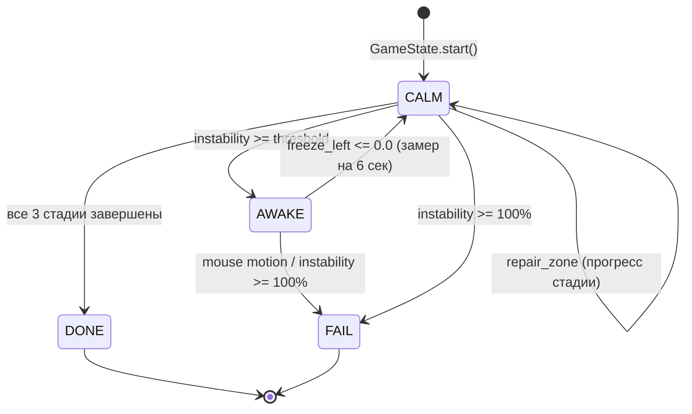

# Архитектура проекта Do Not Wake

Документ архитектуры ядра и игрового цикла для блока «Программирование» (НТО РКИ 26/27, команда Evilbyte Studio).

## 1. Архитектурные слои (Layered Architecture)

```
┌────────────────────────────────────────────────────────┐
│                   Data Layer (JSON)                    │
│   res://data/robot.json  ·  res://data/palette.json    │
│   res://data/parallax.json                             │
└───────────────────────────┬────────────────────────────┘
                            │
┌───────────────────────────▼────────────────────────────┐
│                   Core Domain Logic                    │
│   Balance.gd · Robot.gd · RepairStage.gd · GameState.gd │
└───────────────────────────┬────────────────────────────┘
                            │ (Signals & State)
┌───────────────────────────▼────────────────────────────┐
│                 Presentation / UI View                 │
│   MainView (main.gd) · MainMenu.gd · EndScreen.gd      │
└───────────────────────────┬────────────────────────────┘
                            │
┌───────────────────────────▼────────────────────────────┐
│                   Juice & Post-Process                 │
│   shaders/crt_screen.gdshader · assets/sounds/*.wav    │
└────────────────────────────────────────────────────────┘
```

## 2. Модули ядра (`scripts/core/`)

| Класс | Базовый тип | Ответственность | Зависимости |
|---|---|---|---|
| `Balance` | `RefCounted` | Загрузка конфигурации `data/robot.json`, типизированные геттеры с дефолтами | `FileAccess`, `JSON` |
| `Robot` | `RefCounted` | Состояние стабильности, порог пробуждения, деградация при простое, нагрев | Чистая математика |
| `RepairStage` | `RefCounted` | Описание этапа ремонта (зоны, требуемые инструменты, валидация применения) | Чистые структуры данных |
| `GameState` | `Node` | FSM состояний (`CALM`, `AWAKE`, `DONE`, `FAIL`), смена этапов, таймер замирания | `Robot`, `RepairStage`, `Balance` |
| `ParallaxRig` | `RefCounted` | 2.5D-глубина: целочисленные смещения слоёв от позиции мыши, сглаживание, `reset()`/`snap()` | `FileAccess`, `JSON` |

## 3. Конечный автомат состояний (FSM)



## 4. Поток данных и обработка действий

```
1. Клик игрока -> MainView._handle_click(pos)
2. Проверка выбранного инструмента (cloth / screwdriver / keyboard)
3. Применение к зоне текущего этапа -> GameState.apply_repair(zone_idx, tool_id)
4. RepairStage.try_repair():
   ├─ Правильный инструмент:
   │  └─ instability -= reward, zone.done = true
   │  └─ SFX: repair_success.wav
   │  └─ Если все зоны стадии закрыты -> advance_stage()
   │     └─ Стадия 1 (Чистка) -> Стадия 2 (Замена) -> Стадия 3 (Прошивка) -> DONE
   └─ Ошибка инструмента:
      └─ instability += penalty
      └─ SFX: error_buzz.wav, Screen Shake, вспышка тревоги
      └─ Если instability >= threshold -> GameState.wake() -> состояние AWAKE

5. Фаза AWAKE:
   ├─ Запуск обратного отсчёта замирания (6.0 сек)
   ├─ Движение мыши выше порога -> штраф нестабильности (+15%) и +1.5 сек к замиранию
   └─ По истечении таймера -> calm_down() (снижение порога пробуждения)
```

## 5. Полный игровой цикл (Core Loop & Stages)

1. **Этап 1: Чистка контактов** (Инструмент: `cloth`). Игрок удаляет нагар и масло с сервопривода.
2. **Этап 2: Замена силовой панели** (Инструмент: `screwdriver`). Вскрытие крепежа и монтаж исправного модуля.
3. **Этап 3: Диагностика и прошивка** (Инструмент: `keyboard`). Ввод команд в порт терминала для сброса аварийных регистров.

## 6. Что даёт Data-Driven архитектура

Все числовые коэффициенты (начальная нестабильность, порог пробуждения, шаг снижения порога, чувствительность замирания, список этапов и координаты зон) вынесены в `data/robot.json`.
Чтобы добавить нового робота (например, модель 2 с 4 зонами и повышенной чувствительностью к движению), **не требуется изменять ни единой строчки GDScript-кода**: достаточно передать другой JSON-файл в `Balance`.

## 7. Параллакс (2.5D-глубина)

Один общий риг `ParallaxRig` (`scripts/core/parallax.gd`) обслуживает и игровую сцену, и меню. Экземпляр создаёт сцена (`MainView` / `MainMenu`) — автолоада нет.

1. Позиция мыши берётся в координатах канваса (`get_global_mouse_position()` + `get_viewport_rect().size`) и нормализуется к `[-1..1]` от центра окна. Радиальный deadzone (`0.06`) отсекает дрожь у центра.
2. Нормаль умножается на амплитуду слоя (`base_amplitude_px`, по умолчанию 4 px), глобальный множитель и `depth` слоя. Сдвиг каждого слоя ограничен `max_offset_px` (5 px) и округляется `Vector2.round()`: смещения всегда целые, Nearest-фильтр остаётся резким.
3. Сглаживание экспоненциальное: `lerp(текущее, цель, 1 - exp(-smoothing * delta))`, `smoothing = 9`.
4. `reset()` обнуляет смещение (старт, потеря фокуса окна), `snap()` мгновенно применяет цель без догоняния.

Единая логика знаков: мышь правее/ниже центра — все слои едут вправо/вниз, дальний сильнее. HUD и тулбар — неподвижная рамка.

| Слой | depth | Амплитуда (px, макс) | Что входит |
|---|---|---|---|
| `far` | 1.0 | 4 | фон комнаты |
| `mid` | 0.45 | 2 | верстак, робот, зоны ремонта |
| `near` | 0.15 | 1 | панель инструментов, мелкие детали |
| `ui` | 0.0 | 0 | статус-бары, текст, тревога, HUD |
| `menu_bezel` | 0.4 | 2 | корпус ТВ |
| `menu_screen` | 0.8 | 5 | ЭЛТ-экран и его содержимое |
| `menu_deck` | 0.5 | 3 | VHS-привод |

Слои `menu_*` берут собственную амплитуду 6 px (поле `amplitude_px` слоя), игровые — базовую 4 px.

Важно: `_draw()` и `_handle_click()` получают смещение из одного метода `_layer_shift(layer)`, поэтому клики совпадают с картинкой; `screen_shake` добавляется поверх только при отрисовке. В меню сдвигается `position` узлов, поэтому Button внутри сдвинутого `CRTScreen` остаётся кликабельным, а полноэкранный `CRTPostProcess` не двигается.

Как добавить слой: дописать в `data/parallax.json` в `layers` запись `"имя": {"depth": 0.7, "amplitude_px": 6.0}` (`amplitude_px` опционален) и вызвать `parallax.offset_for_layer("имя")` в `_draw()` / `_apply_parallax()` (и в `_handle_click()`, если по слою кликают).
