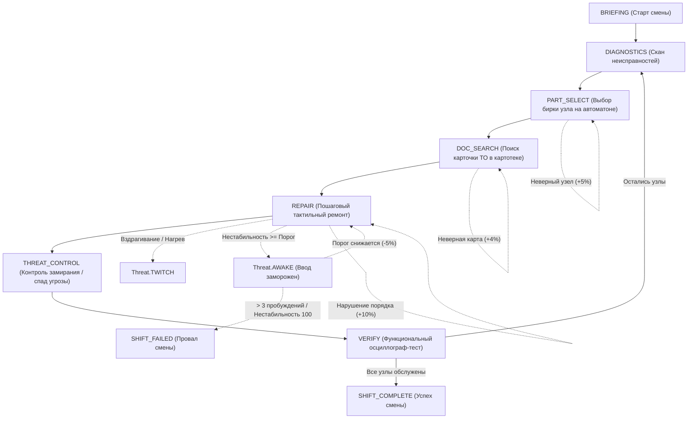

# Документация игровой петли: Do Not Wake

> Статус: зафиксировано для этапа 1.  
> Источники данных: `data/robot.json`, `data/parts.json`, `data/documents.json`, `docs/design/decisions.md`.

---

## 1. Концепция и Core Loop

### 1.1 Core Fantasy
Игрок выступает в роли сервисного инженера аварийного ремонтного бокса. Перед ним на стене в стапеле удержания зафиксирован двухметровый спящий автоматон. Задача техника — провести регламентное обслуживание неисправных узлов машины в строгом соответствии с формуляром техобслуживания (ТО), не допустив превышения порога нестабильности и пробуждения робота.

### 1.2 Архитектура петли (Core Loop)
Игровой цикл декомпозирован на микро-, мезо- и мета-уровни:
- **Micro-цикл (3–10 сек):** Тактильное мануальное действие (протирка ветошью, вращение отвёртки, позиционирование кабеля, удержание курсора) с контролем физических параметров (скорость, ускорение, угол, смещение).
- **Meso-цикл (1–3 мин):** Обслуживание одной неисправной детали: диагностика $\rightarrow$ определение узла $\rightarrow$ поиск формуляра в картотеке $\rightarrow$ регламентный ремонт $\rightarrow$ контроль угрозы (замирание) $\rightarrow$ функциональная проверка (VERIFY).
- **Meta-цикл (смена 5–10 мин):** Завершение смены (обслуживание всех назначенных узлов) в пределах лимита времени (600 сек) и лимита пробуждений ($\le 3$).

---

## 2. Фазы петли и правила переходов

| Фаза (`Phase`) | Событие-триггер | Следующая фаза | Условие / Поведение системы | Фидбек игроку |
|---|---|---|---|---|
| **BRIEFING** | `start_shift()` | `DIAGNOSTICS` | Инициализация смены, сброс таймеров, робот в состоянии `CALM`. | Щелчок рубильника освещения, загорается сигнальная лампа бокса. |
| **DIAGNOSTICS** | `run_diagnostics()` (таймер 2.0 с) | `PART_SELECT` | Автоматический опрос шины данных, генерация отчёта о неисправностях с кодами и симптомами. | Стрекотание термопринтера диагностики, писк осциллографа. |
| **PART_SELECT** | `select_part(id)` | `DOC_SEARCH` | Игрок выбирает бирку детали (`tag_pos`) на роботе. Верный выбор переводит в поиск документов. Ошибка: штраф `wrong_part_penalty` (+5.0%). При наведении отображается диегетический шильдик `component_name`. | Подсветка бирки (`Cloud White`), металлический клик. При ошибке: скрежет реле, вспышка `Alert`. |
| **DOC_SEARCH** | `read_card(id)` + `begin_repair()` | `REPAIR` | Выдвижение ящика картотеки (`A/B/C`), выбор формуляра по тегу. Верная карта открывает формуляр. Ошибка: штраф `wrong_doc_penalty` (+4.0%). | Шелест бумажных карточек, глухой стук деревянного ящика. |
| **REPAIR** | Выполнение всех шагов | `THREAT_CONTROL` | Поочерёдное выполнение тактильных шагов из `order`. Нарушение порядка или не тот инструмент: штраф `order_penalty` (+10.0%). Таймаут шага: штраф `timeout_penalty` (+8.0%). | Интерактивные звуки инструмента, стирание грязи, выпадающие болты, щелчок байонета. |
| **THREAT_CONTROL** | Выдержка удержания `hold_seconds` (3.0 с) | `VERIFY` | Курсор неподвижен (`motion_limit` $\le 1.2$ px/frame) в течение 3.0 с при `safe_margin` 10.0%. Успокаивает автоматику перед пуском. | Затухающий гул гидравлики, индикатор готовности к проверке. |
| **VERIFY** | `run_verification()` | `DIAGNOSTICS` / `SHIFT_COMPLETE` | Интерактивный тест отклика (импульс). Успех: награда `pass_reward` (-10.0% нестабильности). Провал: штраф `fail_penalty` (+12.0%), повторная попытка (макс. 2). | Чистый тональный синус 440 Гц, зеленая волна на экране при успехе; срыв развёртки при неудаче. |
| **SHIFT_COMPLETE** | Финал | — | Все дефекты устранены, смена сдана. | Финальный аккорд, зелёный штамп «ГОДЕН», экран итоговой статистики. |
| **SHIFT_FAILED** | Превышение лимитов | — | Наступает при: 1) Нестабильность $\ge 100\%$; 2) Число пробуждений $> 3$; 3) Таймаут смены $> 600$ с; 4) Исчерпание попыток `verify`. | Резкий срыв стапеля, аварийная сирена, красный экран тревоги. |

---

## 3. Математика баланса и формулы нестабильности

### 3.1 Динамика нестабильности
Шкала нестабильности $I(t) \in [0.0, 100.0]$:
$$I(t + \Delta t) = \text{clamp}\Big(I(t) + \big(V_{idle} + V_{action} + V_{penalty} - V_{reward}\big) \cdot \Delta t, \quad 0.0, \quad 100.0\Big)$$

- **Базовый дрейф бодрствования ($V_{idle}$):** $+0.45\%$ в секунду (постоянное давление времени).
- **Стартовая нестабильность:** $20.0\%$.
- **Базовый порог пробуждения ($T_{threshold}$):** $70.0\%$.
- **Деградация порога:** $-5.0\%$ за каждое пробуждение (минимальный предел: $40.0\%$).

### 3.2 Матрица штрафов и наград (из `data/robot.json` и `data/parts.json`)

| Событие | Влияние на нестабильность | Ограничения и параметры |
|---|---|---|
| Ошибка выбора детали (`wrong_part_penalty`) | $+5.0\%$ | Штраф начисляется сразу при клике на неверную бирку |
| Ошибка выбора карточки (`wrong_doc_penalty`) | $+4.0\%$ | Начисляется при подтверждении неверного формуляра |
| Нарушение порядка шагов / не тот инструмент (`order_penalty`) | $+10.0\%$ | Шаг сбрасывается и перезапускается |
| Таймаут тактильного шага (`timeout_penalty`) | $+8.0\%$ | Начисляется при превышении `time_limit` шага |
| Успешное выполнение шага ремонта | $-4.0\% \dots -6.0\%$ | Снижает текущее напряжение системы |
| Ошибка/срыв в шаге (перегрев, срыв шлица) | $+6.0\% \dots +10.0\%$ | Локальный срыв инструмента (`hazard`) |
| Успех верификации узла (`pass_reward`) | $-10.0\%$ | Окончательное подтверждение ремонта узла |
| Провал верификации узла (`fail_penalty`) | $+12.0\%$ | Допускается не более 2 попыток (`max_attempts: 2`) |
| Общий лимит смены (`shift_time_limit`) | $600.0$ сек (10 мин) | При исчерпании — немедленный `SHIFT_FAILED` |

### 3.3 Механика тактической паузы («Переждать и охладить»)
Игрок может остановить манипуляции в фазах `REPAIR` и `THREAT_CONTROL`, если робот находится в состоянии `Threat.CALM`:
- **Скорость охлаждения (`cool_rate`):** $-1.2\%$ в секунду.
- **Максимальная длительность паузы (`max_seconds`):** $25.0$ сек (после чего происходит автоматическое возобновление).
- **Задержка разблокировки ввода (`resume_delay`):** $0.6$ сек (предотвращает спам кликами).
- **Перезарядка паузы (`cooldown_seconds`):** $20.0$ сек (предотвращает непрерывный абуз сброса).
- **Лимит использований на смену (`max_uses_per_shift`):** $3$ раза за всю 10-минутную смену.

---

## 4. Спецификация деталей вертикального среза

### 4.1 Таблица деталей и регламентов

| Деталь (ID / Tag) | Узел / Зона / Точка (`tag_pos`) | Код / Симптом | Шаги регламента ТО (по порядку) | Инструменты | Норма времени | Награда / Штраф |
|---|---|---|---|---|---|---|
| **`srv_04`** `A-04` | Сервопривод плечевого шарнира Зона: `shoulder` `tag_pos`: `[612, 236]` | `E-217` Дрожание манипулятора под нагрузкой | 1. `clean_contacts` (scrub) 2. `lock_cable` (cable_lock) | Ветошь (`cloth`) Кабель (`cable`) | $60$ с (окна: $25+15=40$ с) | $+8.0$ / $-10.0$ |
| **`pwr_02`** `B-02` | Блок питания и шина распределения Зона: `chest` `tag_pos`: `[640, 360]` | `P-044` Падение напряжения в цепи | 1. `unbolt_hatch` (unbolt) 2. `clean_bus` (scrub) 3. `stabilize_power` (hold) | Отвёртка (`screwdriver`) Ветошь (`cloth`) Руки (`none`) | $80$ с (окна: $30+20+15=65$ с) | $+10.0$ / $-12.0$ |
| **`opt_07`** `C-07` | Визорный оптический сенсор Зона: `head` `tag_pos`: `[640, 140]` | `O-103` Рассинхронизация скан-луча | 1. `calibrate_optic` (calibrate) 2. `verify_optic` (hold) | Кабель (`cable`) Руки (`none`) | $50$ с (окна: $20+15=35$ с) | $+10.0$ / $-12.0$ |

---

## 5. Эмоциональная карта игрока («Что чувствует игрок»)

1. **`srv_04` (Шаг 1: `clean_contacts`):** *«Осторожность и ритм»* — игрок нащупывает безопасную скорость движения ветоши, слушая шорох ткани и боясь перегрева.
2. **`srv_04` (Шаг 2: `lock_cable`):** *«Тактильное облегчение»* — тяжелый штекер направляется к гнезду, точный поворот паза на 12 часов и удовлетворяющий сочный щелчок замка.
3. **`pwr_02` (Шаг 1: `unbolt_hatch`):** *«Механическое напряжение»* — круговые движения отвёрткой требуют плавности: каждый оборот отдаётся храповиком, а страх сорвать шлиц держит в фокусе.
4. **`pwr_02` (Шаг 2: `clean_bus`):** *«Уверенность мастера»* — после снятия тяжелого люка протирка медной шины воспринимается как четкая рутинная работа профессионала.
5. **`pwr_02` (Шаг 3: `stabilize_power`):** *«Затаённое дыхание»* — игрок замирает вместе с курсором над открытой силовой цепью, ожидая щелчка реле стабилизации напряжения.
6. **`opt_07` (Шаг 1: `calibrate_optic`):** *«Хирургическая микромоторика»* — аккуратная подгонка луча скан-визора кабельным регулятором, балансирование на тонкой грани допуска $\pm 5$ единиц.
7. **`opt_07` (Шаг 2: `verify_optic`):** *«Опасный визуальный контакт»* — удержание курсора на мерцающем визоре спящего исполина, встреча взглядом с машиной тет-а-тет.

---

## 6. Открытые вопросы для плейтеста (Playtest Backlog)

1. **Читаемость симптомов против бирок:** Легко ли игроку сопоставить симптом из диагностического листа («Падение напряжения в цепи») с нужным узлом автоматона (грудной люк `B-02`), опираясь на всплывающий диегетический шильдик?
2. **Ощущение честности срыва отвёртки:** Не воспринимается ли срыв шлица при $a > 2500$ px/s² как излишне карающий или случайный? Достаточно ли ясен звуковой и визуальный предвестник срыва?
3. **Понимание механики паузы:** Понимает ли игрок, что во время нарастания нестабильности можно добровольно остановиться и сбросить напряжение через паузу, или он панически продолжает ремонт вплоть до пробуждения?
4. **Достаточность нормы времени:** Укладываются ли новички в норматив `time_norm_sec` (60–80 с на деталь) с учётом времени на чтение картотеки, или норматив вызывает спешку и хаотичные клики?
5. **Интуитивность типа шага `hold` без инструмента:** Понятно ли игроку из текста регламента («Удерживать в покое»), что для стабилизации не нужен инструмент из лотка, а требуется удерживать курсор неподвижно в границах зоны?
